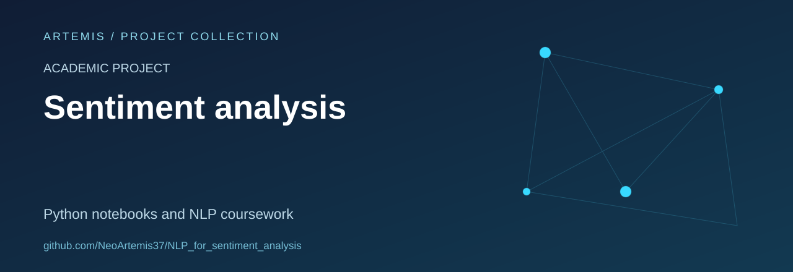

# Sentiment Analysis Learning Pipeline

A student project exploring how text can be cleaned, represented and classified for sentiment analysis.

**Status:** educational research archive. **Stack:** Python and Jupyter notebooks, with saved TF-IDF and model artefacts.

## Pipeline

The repository is organised around successive stages:

1. Collection-related scripts and source tables in `scrapping/`.
2. Cleaning and preprocessing notebooks in `prétraitement/`.
3. Text vectorisation and feature exploration in `vectorization/`.
4. Annotation, evaluation figures and a report in `annotation_evaluation_resultats/`.

The folders contain both working material and saved outputs. They do not form a packaged API or a deployed service.

## Explore the work

- [`vectorization/vectorisation.ipynb`](vectorization/vectorisation.ipynb) follows the text-representation stage.
- [`annotation_evaluation_resultats/annotated.ipynb`](annotation_evaluation_resultats/annotated.ipynb) contains annotation/evaluation work.
- [`annotation_evaluation_resultats/`](annotation_evaluation_resultats/) includes figures, a confusion-matrix image and the historical report.

The study material refers to UVBF. This is a learning project, not a claim of an official institutional engagement or endorsement.

## Reproducibility and limits

No complete dependency manifest or automated evaluation pipeline is included. Metrics should be interpreted with the dataset split and methodology recorded in the notebooks and report; no benchmark score is claimed by this README.

The tracked tables and saved models are historical artefacts. Dataset provenance, reuse permissions and removal of unnecessary personal information should be checked before sharing new data or derived exports.

## Useful contributions

Document the environment, clarify data provenance, separate intermediate data from final results and add a small reproducible evaluation using appropriately licensed or synthetic text.

No repository-wide licence file is currently included.
